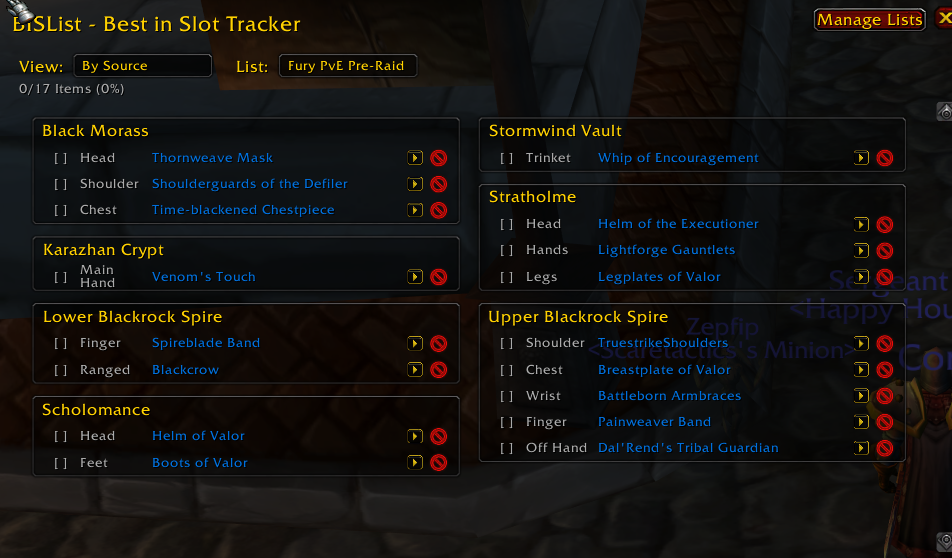

# BISList

A Best-in-Slot list addon for World of Warcraft 1.12.1 (Vanilla / Turtle WoW).
Track the gear you want for every equipment slot across multiple lists (`Leveling`, `PvE`, `PvP`, or custom lists), and automatically mark items as acquired once they are equipped, in your bags, or in your bank.

Forked from the original **BISList** by **gabcinder2004**.

---

## Optional Client Mod (DLL)

| Mod | Status | What BISList uses it for | Link |
|---|---|---|---|
| **ClassicAPI** | Optional | Reads bank item counts without visiting a banker (`C_Item.GetItemCount`), fetches uncached item data from the server (`C_Item.RequestLoadItemDataByID` / `ITEM_DATA_LOAD_RESULT`), and reads hovered items from any `GameTooltip` (`GameTooltip:GetItem`) | [ClassicAPI](https://github.com/brues-code/ClassicAPI) |

> BISList works out of the box on a stock 1.12.1 client without any DLL mods. ClassicAPI is auto-detected at runtime and falls back cleanly when absent.

---

## Features

- **Multiple lists per character** — `Leveling`, `PvE`, and `PvP` by default; create, rename, delete, and move items between lists.
- **Automatic acquisition tracking** — Scans equipped gear, bags, and bank (cold bank scan when ClassicAPI is present; bank-window scan on stock clients) across all lists.
- **Conflict-free quick add/remove (`Ctrl+Alt+Click`)** — Works directly on items in **AtlasLoot** (main loot tables and Tier/Container popups, without triggering AtlasLoot WishList), **pfQuest** (`pfBrowser`), **InstanceJournal**, and **chat item links**. Clicking an already-listed item removes it.
- **Universal hover keybind (`Alt+Shift+B`)** — Hover any item anywhere (bags, character/inspect sheet, quest rewards, merchant, auction house, loot/roll windows, mail, AtlasLoot, pfQuest, Bagshui, etc.) and press `Alt+Shift+B` to add or remove it. Avoids `Alt+B` bag keybind conflicts.
- **One-hand weapon slot prompt** — `INVTYPE_WEAPON` items prompt you to choose **Main Hand** or **Off Hand** instead of filing into an ambiguous bucket.
- **Source tracking** — Captures AtlasLoot dungeon/boss source info when adding from AtlasLoot.
- **Minimap button & progress stats** — Draggable, pfUI-compatible minimap button and per-list acquired/total completion counter.

---

## Controls & Slash Commands

### Adding & Removing Items

| Action | Where it works | Behavior |
|---|---|---|
| **`Ctrl + Alt + Click`** | AtlasLoot, pfQuest (`pfBrowser`), Chat links, `SetItemRef` addons | Add item to current list (or remove if already present) |
| **`Alt + Shift + B`** *(hover)* | Any `GameTooltip` / `AtlasLootTooltip` item | Add hovered item to current list (or remove if already present) |
| **Rebind** | `ESC > Key Bindings > BISList` | Customize the hover keybind |

### Slash Commands

| Command | Description |
|---|---|
| `/bis` or `/bislist` | Toggle the BISList window |
| `/bistest` | Manually add/toggle the currently hovered item |
| `/bisdebug` | Toggle verbose debug logging |
| `/bischeck` | Print diagnostic info for the frame/tooltip under your cursor |

---

## What's Changed vs Upstream

- **Conflict-free AtlasLoot & pfQuest integration (`Ctrl+Alt+Click` & `ALT-SHIFT-B`):**
  - Replaced `ALT-B` default keybind (which conflicted with bag keybinds) with `ALT-SHIFT-B`, and avoided overwriting existing bindings on login.
  - Replaced plain `Alt+Click` in `SetItemRef` / `ChatEdit_InsertLink` with `Ctrl+Alt+Click`, and hooked `AtlasLoot.Item_OnClick` and `AtlasLoot.ContainerItem_OnClick` so `Ctrl+Alt+Click` adds/removes in BISList while leaving AtlasLoot's `Alt+Click` WishList intact.
  - Unified click and keybind flows through `BISListContextMenu:AddOrToggleItem` so weapon prompts, toggle-remove, item names, and ClassicAPI uncached-item fetching behave identically everywhere.
- **Expanded tooltip capture & bug fixes:**
  - Added `GameTooltip:GetItem()` support (ClassicAPI) plus Vanilla hooks for `SetQuestItem`, `SetQuestLogItem`, `SetMerchantItem`, `SetAuctionItem`, `SetLootRollItem`, and `SetInboxItem`.
  - Cleared stale `lastHoveredSourceInfo` when hovering non-AtlasLoot items so AtlasLoot boss sources no longer leak onto bag or pfQuest items.
  - Throttled the tooltip `OnUpdate` scanner (`0.05s`) and guarded `Core.lua` against empty `itemName` strings and `nil` `GetContainerNumSlots` returns.
- **Acquisition & UI fixes:**
  - Fixed bank items losing their acquired checkmark when closing the bank window (`IsItemAcquired` + `ApplyAcquiredResult`).
  - Updated `ScanAllItems` to scan every list on the character, not just the currently viewed list.
  - Restored the `INVTYPE_WEAPON` Main Hand / Off Hand prompt in `GetItemSlot` / `OnMenuClick`.
  - Updated minimap button drag math to use `Minimap:GetCenter()` for scale-safe positioning.
  - Added optional ClassicAPI `C_Item.GetItemCount` cold bank scanning and `C_Item.RequestLoadItemDataByID` async item loading.

---

## Credits

- Original addon by **gabcinder2004**
- ClassicAPI by **brues-code** — <https://github.com/brues-code/ClassicAPI>
